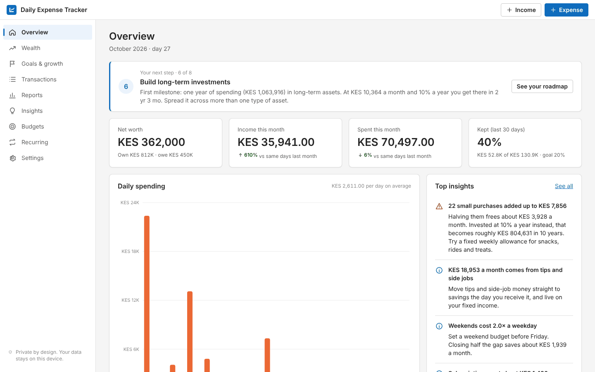
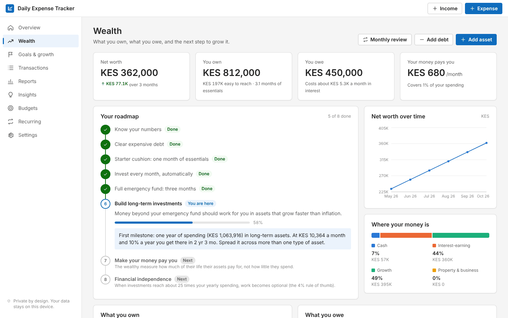
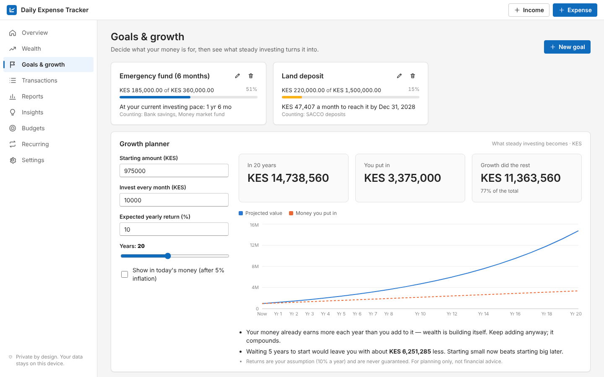
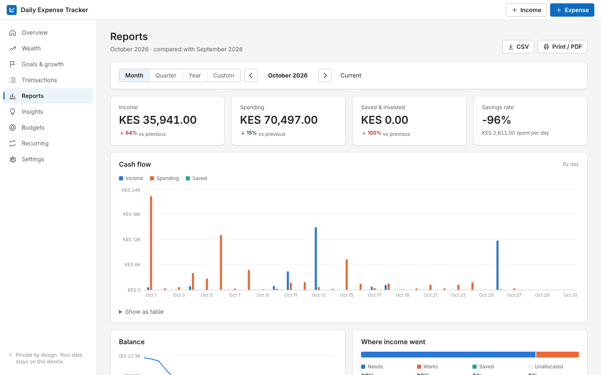
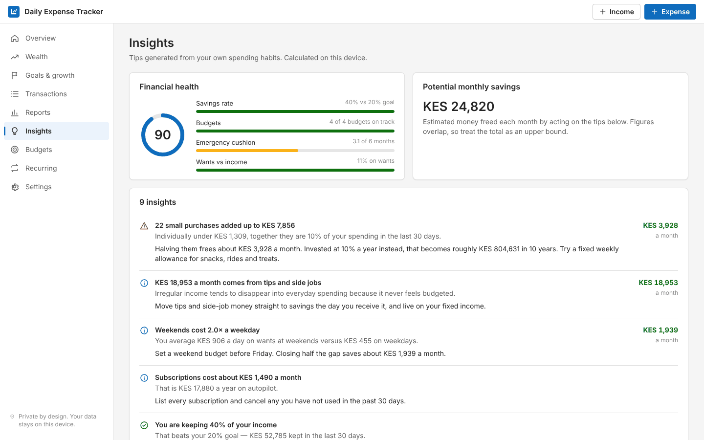
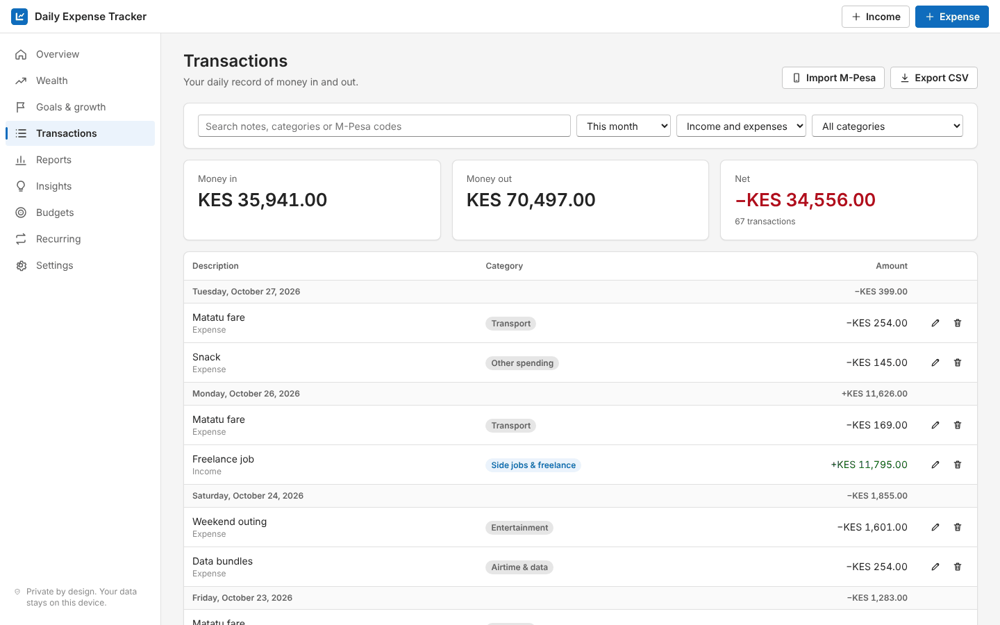
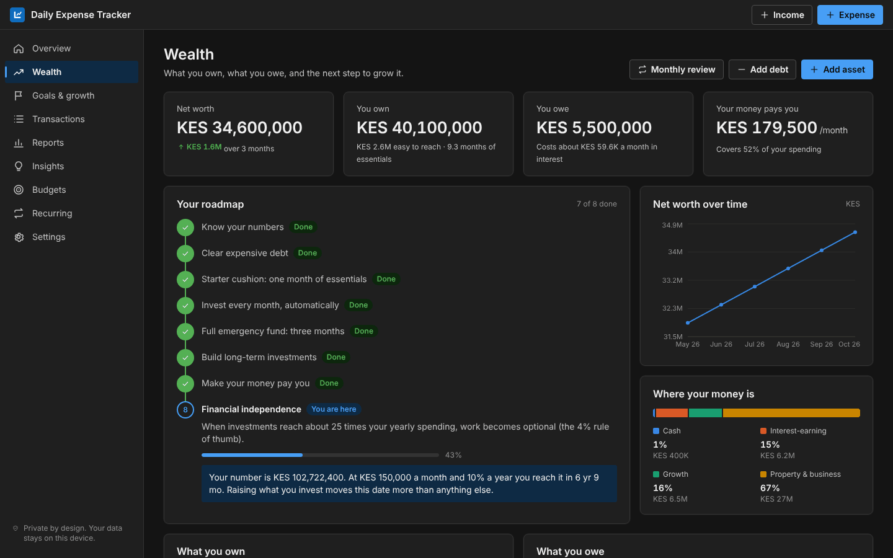
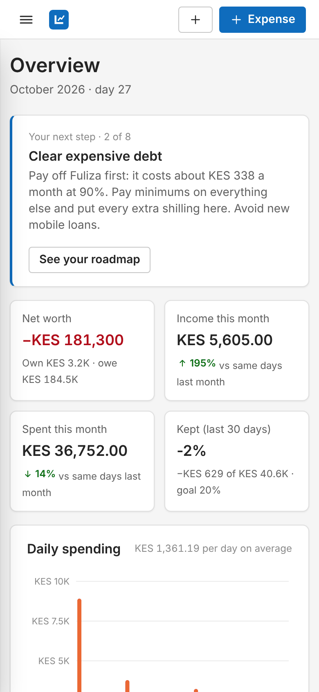

# Daily Expense Tracker

[](https://github.com/Giathi-Daniel/DailyExpenseTracker/actions/workflows/ci.yml)
[](https://github.com/Giathi-Daniel/DailyExpenseTracker/actions/workflows/deploy.yml)
[](LICENSE)

**Live demo: [giathi-daniel.github.io/DailyExpenseTracker](https://giathi-daniel.github.io/DailyExpenseTracker/)** — pick a sample (fresh graduate, salaried professional or established investor) to try it without entering anything.

A private, local-first app for building wealth, not just tracking spending. It shows your net worth, gives you one clear next step from wherever you start — a graduate clearing a Fuliza balance or an investor approaching financial independence — and projects what steady investing becomes. Income, daily spending, reports and automatic insights are all built in. No account, no server, no tracking: data stays on the device and can be encrypted with a passphrase.



## Building wealth

- **Net worth** — record what you own (cash, savings, money market funds, SACCOs, bonds, shares, pensions, property, business) and what you owe (mobile loans, cards, student, car, mortgage). A monthly review takes two minutes and keeps a net-worth history.
- **An eight-step roadmap that meets you where you are**: know your numbers → clear expensive debt → starter cushion → invest automatically → three-month emergency fund → long-term investments → make your money pay you → financial independence. Each step says why it matters and what to do next, with your own figures (“Pay off Fuliza first: it costs about KES 338 a month at 90%”).
- **Investments that move with your money** — link a savings payment or a recurring transfer to an asset and its value updates automatically; editing, deleting or undoing the payment reverses it.
- **Goals** with progress from linked assets and the monthly amount needed to hit a date.
- **Growth planner** — starting amount, monthly investment, return and years → projected value vs money put in, the year your money starts out-earning your contributions, and what waiting five years would cost. Optional inflation-adjusted view.
- **What a habit really costs** — a daily spend shown as what it becomes if invested instead over 5–30 years.
- **Wealth insights** — expensive-debt cost, idle cash losing to inflation, concentration in one asset type, real (after-inflation) returns, passive income cover and net-worth trend, alongside the spending insights.
- Every figure is the owner’s own record and assumption; nothing recommends a specific product.

| Wealth | Goals & growth |
| --- | --- |
|  |  |

## Tracking and reports

- **Income from any source** — salary, side jobs, tips, business, gifts — and **daily expenses** grouped as needs, wants or savings.
- **Recurring entries** — salary on the 28th, rent on the 1st, weekly chama contributions. Entered once, posted automatically (including the months the app was closed). Month-end dates clamp correctly (Jan 31 → Feb 28).
- **M-Pesa import** — paste confirmation SMS in bulk. Sent, paid, Paybill, received, withdrawal and airtime messages are parsed, auto-categorised (Naivas → Groceries, KPLC → Utilities…), transaction costs captured as fees, phone numbers stripped, and duplicates skipped by transaction code.
- **Reports** — month, quarter, year or any custom range; every figure compared with the previous period. Cash-flow and balance charts, category and income-source breakdowns, largest expenses, table view of chart data, CSV export and print-to-PDF.
- **Automatic insights** — 19 rules over your data, including: savings rate vs goal, budget pace with a daily allowance, category spikes vs your 90-day baseline, small-purchase leakage, 50/30/20 split, weekend vs weekday spending, subscriptions, fees, debt load, emergency-fund cover, income concentration, pay-yourself-first, no-spend days. Each tip states why it fired and how much acting on it is worth per month. A 0–100 financial health score summarises them.
- **Budgets** with projected month-end spend, “safe to spend per day”, and one-click budgets suggested from your history.
- **Installable and offline** (PWA), light and dark themes, keyboard shortcuts (`E` expense, `I` income), responsive on phones, accessible markup (native `<dialog>`, labelled controls, live regions).

| Reports | Insights |
| --- | --- |
|  |  |

| Transactions | Dark | Mobile |
| --- | --- | --- |
|  |  |  |

## Security model

| Concern | Control |
| --- | --- |
| Data at rest | Optional AES-256-GCM encryption via Web Crypto. Key derived with PBKDF2-SHA256, 600,000 iterations, random 16-byte salt; fresh 12-byte IV per write. Keys are non-extractable; the passphrase is never stored. |
| Tampering | GCM authentication rejects modified ciphertext. Every load and import is validated with Zod schemas (types, bounds, referential integrity) before use. KDF parameters read from storage are bounds-checked, so a downgraded iteration count is refused. |
| XSS | Strict Content-Security-Policy (`script-src 'self'`, no inline scripts or styles, `connect-src 'self'`, `object-src 'none'`). No `dangerouslySetInnerHTML`, no third-party scripts, fonts or analytics. |
| Shared devices | Auto-lock after inactivity, manual lock, escalating delay after repeated wrong passphrases. |
| Data loss | Older saved data and backups are upgraded automatically (schema v1 → v2) with no loss. Unreadable storage is quarantined, never overwritten. Plain and encrypted JSON backups, merge-or-replace restore. Multiple open tabs stay in sync. |
| Exports | CSV cells starting with `= + - @` are neutralised to prevent spreadsheet formula injection (CWE-1236). Backup imports are size-capped. |
| Money maths | All amounts are integer minor units (cents) parsed from strings — no floating-point drift. |

`public/_headers` sets the same CSP plus `frame-ancestors 'none'`, HSTS, `nosniff`, `Referrer-Policy` and `Permissions-Policy` on hosts that support header files (Netlify, Cloudflare Pages).

## Architecture

```
src/
  core/       Pure, framework-free domain logic (fully unit-tested)
    schema.ts     Zod schemas: the single source of truth for persisted data
    money.ts      Integer minor-unit parsing and formatting
    dates.ts      Timezone-safe calendar arithmetic on YYYY-MM-DD strings
    ledger.ts     Reducer, recurring-entry engine, merge
    reports.ts    Period maths, summaries, time series, balances
    insights.ts   Spending and wealth rules, health score
    wealth.ts     Net worth, debt cost, compound growth, goals, roadmap
    mpesa.ts      M-Pesa SMS parser and merchant categoriser
    csv.ts        Injection-safe CSV export
  storage/    Encrypted vault on localStorage, backups
  ui/         React 19 app: store, pages, charts (Recharts), components
```

The domain layer has no React or browser dependencies, so the same logic can back a server, a mobile app or a CLI later. Pages are code-split; charts load only on the pages that use them.

## Run it

```bash
npm install
npm run dev         # http://localhost:5173
npm test            # unit, storage and UI tests
npm run typecheck
npm run build       # production build in dist/
```

Requires Node 20+. Deploys as static files anywhere. The included workflow publishes to GitHub Pages on every push to `main` (one-time setup: **Settings → Pages → Source: GitHub Actions**).

## Tech stack

React 19 · TypeScript (strict) · Vite · Recharts · Zod · Web Crypto API · Vitest + Testing Library · GitHub Actions · GitHub Pages

## Roadmap

- Optional end-to-end encrypted sync between devices (the server stores ciphertext only), offered as a paid tier.
- Shared household finances, Airtel Money and bank SMS import, CSV import from bank statements.

## License

MIT
